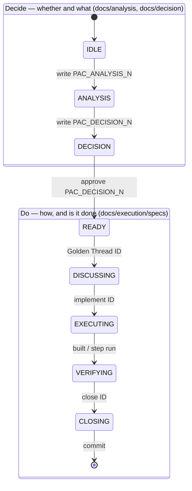

<!-- Reference instance copied from PAC/Source/docs/README.md on 2026-10-15 (blueprint v1). Replace project-specific names (PAC, PAC_, P0.x, paths) when instantiating. -->

# PAC Online — documentation hub

This hub records **why** work is done (analysis → decision), **what** is being done (board → task) and **where it stands**
(status), for all three PAC repositories. Rules for agents: [../AGENTS.md](../AGENTS.md).

## Start here

1. [Current status](status/WAITING_FOR_YOUR_ACTION.md) — the pending action; follow the one file in `status/` if this name changes.
2. [Task board](execution/specs/board.md) — the only task table.
3. [PAC_DECISION_1](decision/PAC_DECISION_1_2026-10-15.md) — the onboarding plan (P0.1–P0.10) and its owner checks.
4. [Architecture](architecture/README.md) — the three codebases, three databases, config files and verified dependencies.

## Structure

```text
docs/
├── README.md                this file
├── open-questions.md        raised ideas/findings, not yet an analysis or a task
├── status/                  exactly one live status file + history/
├── analysis/                PAC_ANALYSIS_N — evidence, one source or source family per record
├── decision/                PAC_DECISION_N — synthesis, options, Routes to, owner checks
├── architecture/            system landscape (as-documented vs as-verified)
└── execution/
    ├── conventions.md       gates, Golden Thread, evidence, closing, commits, action card
    ├── task-template.md
    └── specs/
        ├── board.md         authoritative task status
        └── tasks/           open task = flat PX.Y-slug.md; closed task = PX.Y-slug/README.md + evidence/
```

## Workflow

**Source / finding → analysis → decision (Routes to) → board → Golden Thread → implement → verify with evidence → close.**



- **Analysis** separates observed facts, source claims, inferences and unknowns, with date and verification method.
- **Decision** cites the analyses it compares, offers options, and declares `Routes to`: `TASKS` / `NONE` / `VALIDATION`.
  A proposed decision is not an accepted plan; only `approve PAC_DECISION_N[, option]` accepts it.
- **Board**: Backlog (Proposed) holds work from a proposed decision; To Do holds approved work. A finding never goes straight
  onto the board — it goes to [open-questions.md](open-questions.md) or an analysis first.
- **Small proven defects** (a clear bug reproduced from evidence) may go straight to a scoped task without a strategy record.
- **Client work items** (JIRA `MDDIPAC-NNN` change requests and incidents) are the PAC equivalent of a decision's origin: the task's
  Origin line cites the JIRA key; an analysis is written only when the CR needs options or sizing.

## Naming

| Kind | Form | Notes |
|---|---|---|
| Analysis | `PAC_ANALYSIS_N_YYYY-MM-DD.md` | Lifecycle inside the file: `RAISED` / `IN_USE` / `ARCHIVED` — never in the file name |
| Decision | `PAC_DECISION_N_YYYY-MM-DD.md` | Disposition inside the file: `PROPOSED` / `ACCEPTED` / `REJECTED` / `SUPERSEDED` |
| Task | `PX.Y-slug` | `X` = initiative, `Y` = order. IDs follow execution order; a not-started task may be renumbered when the order changes, a started one never |
| Sub-task | `PX.Y.N` | Lives inside the parent's folder |
| Commit message | `type(ID): message` | e.g. `docs(PAC_DECISION_1): …`, `fix(P1.2): …` — the ID, never the author |

**Initiatives** (an initiative number, never a roadmap phase):

| Initiative | Meaning | State |
|---|---|---|
| `P0.x` | Local environment setup and verification on Windows | Proposed in PAC_DECISION_1 |
| `P1.x` | Change requests (JIRA CR) — analyse, size, build, UAT support | Not opened; opens with the first CR |
| `P2.x` | Incidents / L3 production support — reproduce from logs, fix | Not opened |
| `P3.x` | Security remediation — SAST / SonarQube / OWASP / VAPT / CVE (e.g. Telerik) | Not opened |
| `P4.x` | Releases — UAT / PROD manual IIS deployment within change windows | Not opened; needs handover doc 3 |

Source of the later initiatives: the role description (`KnowlegeBase/Resume.html`, responsibilities list), cited in PAC_ANALYSIS_1.

## Board states

Backlog (Proposed) → 🔵 To Do → 🟡 In Progress → 🟢 Done; 🔴 Blocked names its dependency and resume condition.

## Status file

Exactly one live file in `status/`: `IN_PROGRESS.md` (a session is working), `WAITING_FOR_YOUR_ACTION.md` (a named owner decision,
action or external prerequisite is pending) or `WAITING_FOR_NEW_TASK.md` (idle). Layout: header → action card → ROAD → PAST →
boxed CURRENT → FUTURE, with separate `👤 HUMAN` / `⚙️ AI` lines (never a combined "both"). PAST entries older than yesterday move
verbatim to `status/history/`. Update it in the same turn as any action, result or change of next step.

## Adapted from Lintent — what was kept and what was dropped

| Lintent element | PAC | Why |
|---|---|---|
| `AGENTS.md` single rule source + `CLAUDE.md` `@AGENTS.md` | Kept, at `Source/` root | Same need: several tools, one rule set |
| Status pattern (PAST → CURRENT → FUTURE, action card) | Kept, simplified (no AGENTS/HANDOFFS blocks) | One hub, so no cross-repo sync block |
| Analysis → Decision → Board, `Routes to`, lifecycle in content | Kept | Traceability of why each task exists |
| Golden Thread, flat open task → folder on close, evidence before done, known commands | Kept | Core discipline |
| Four close commits by kind (R-06) | Kept for the hub; client repos follow the client's branch rules (`CR/<JIRA-KEY>`, `--no-ff`) | Client repos have their own process |
| `docs/` inside each repo | **Dropped** → one hub beside the repos | Repos are the client's |
| Strategy register, wedge strategy, stages, roadmap phases | **Dropped** until needed | PAC is a delivery/maintenance contract driven by client CRs, not a product strategy |
| R-09 review by another agent | Optional — `review <ID>` on request | Only one agent in use so far |
| Screenshot rule (owner drops files, chat images are not evidence) | Kept | Same evidence discipline for IIS pages |
